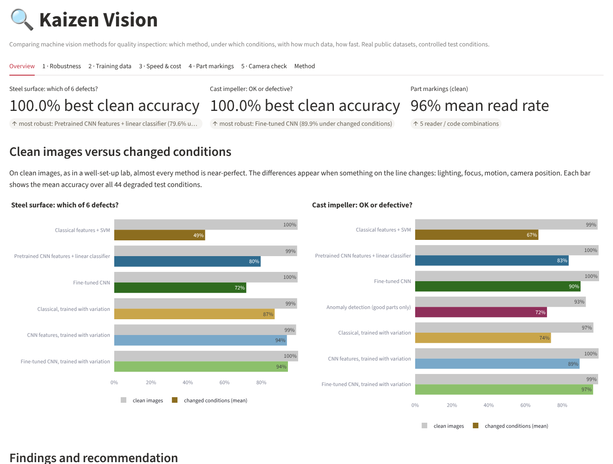
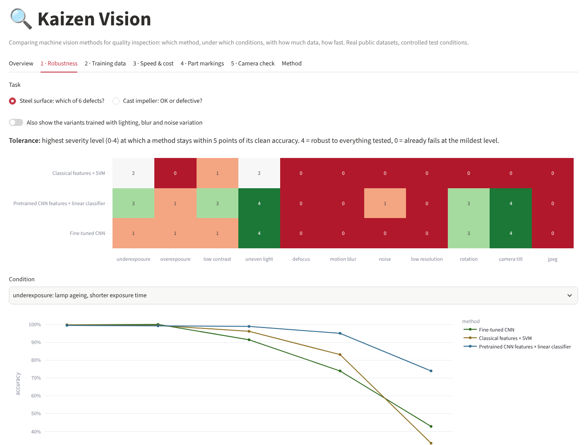
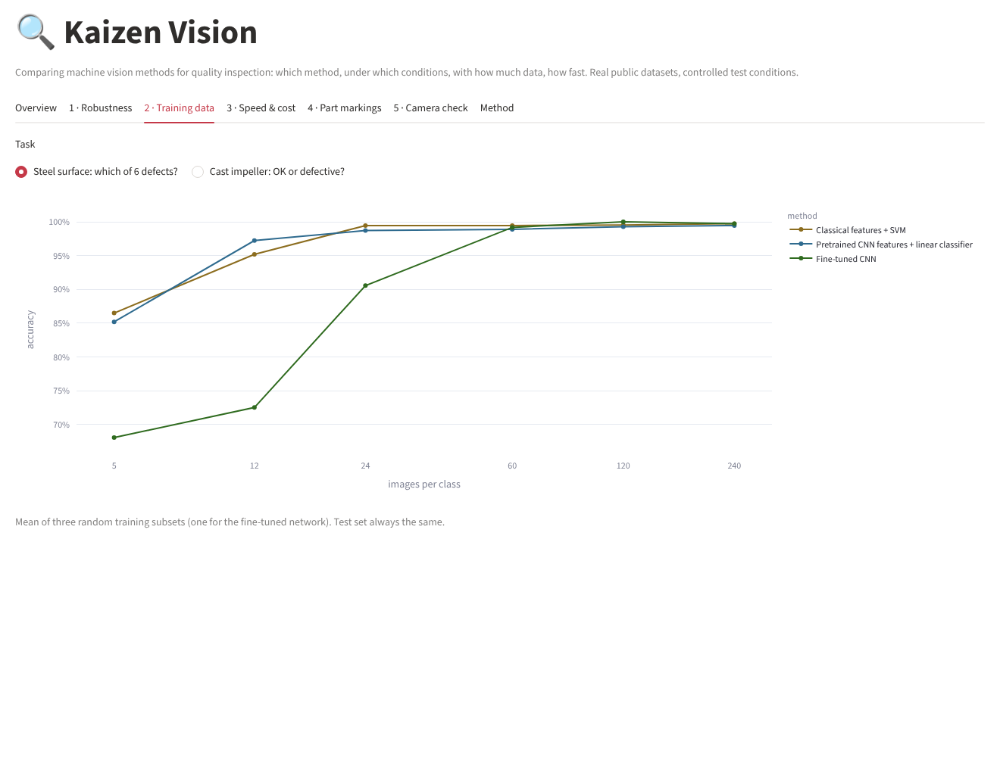
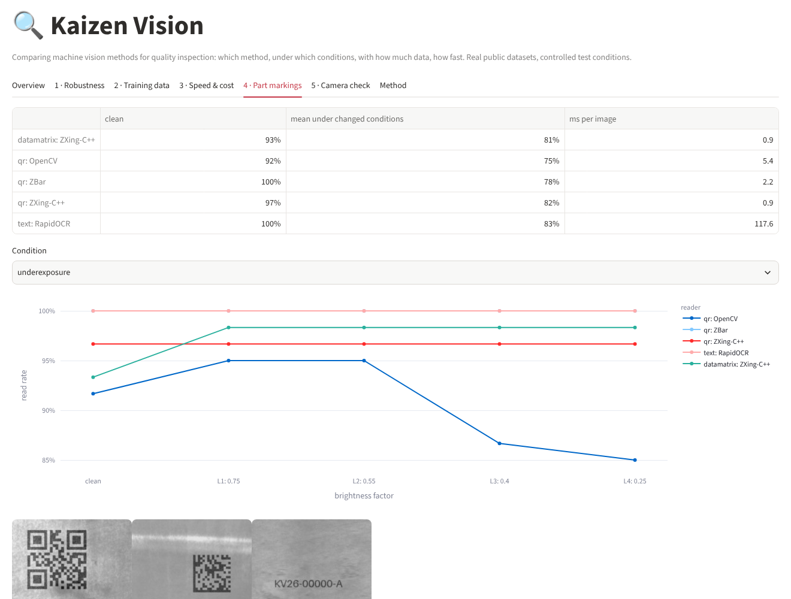
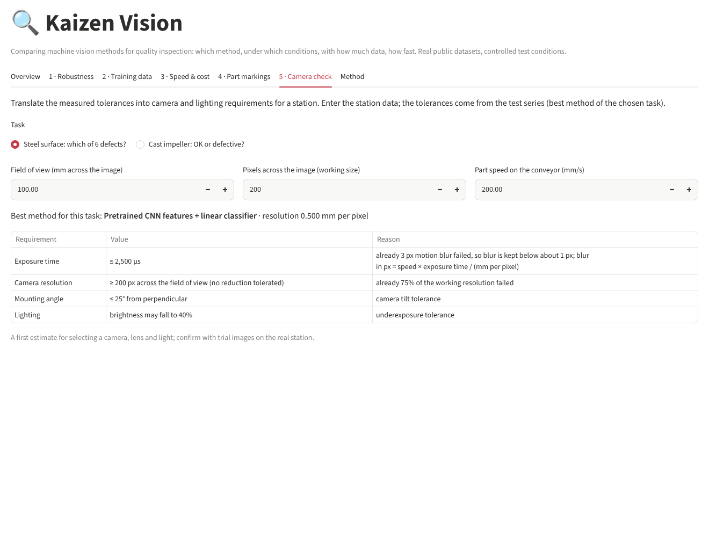
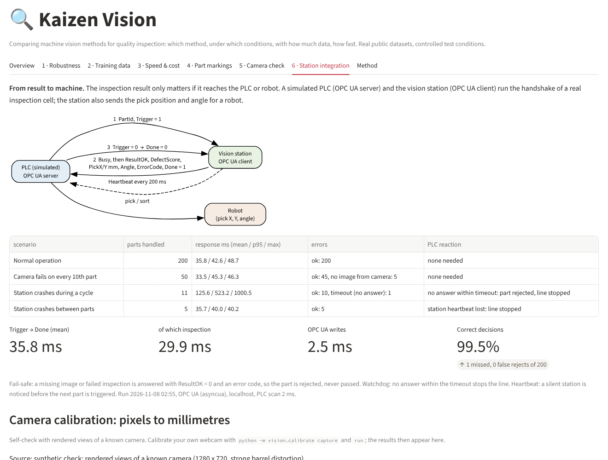

# Kaizen Vision

**Comparing machine vision methods for quality inspection, and connecting the result to the machine.** Four
approaches, two real inspection tasks, a part-marking test and 44 controlled changes to the imaging conditions:
which method should a new inspection station use, what must the camera and lighting deliver, and how does the
result reach the PLC and the robot?

Most vision demos report one accuracy on clean images. In this test series every method reaches 93-100 % on
clean images, so that number does not help with the choice. The differences appear when something on the line
changes: the lamp ages, the focus drifts, the part moves, the camera is mounted at an angle.



## Test series

| | Steel surface | Cast impeller | Part markings |
|---|---|---|---|
| Data | NEU surface defect database: 1,800 real images of hot-rolled steel, 6 defect types | Casting product images: 1,300 real top-view images of pump impellers, OK / defective | QR, Data Matrix and serial-number markings with known content on real steel texture |
| Task | which defect? | OK or defective? | read the code or text |
| Compared | classical features + SVM, pretrained CNN features + linear classifier, fine-tuned CNN | + anomaly detection trained on good parts only | OpenCV, ZBar, ZXing-C++, RapidOCR |

Each method is trained on clean images and then tested:
1. on clean test images,
2. under **11 changed conditions at 4 severity levels** (44 conditions): under- and overexposure, low contrast,
   uneven light, defocus, motion blur, sensor noise, lower resolution, part rotation, camera tilt, JPEG
   compression,
3. with **2 % to 100 % of the training images** (how much data is needed),
4. for **speed** on a laptop CPU,
5. and once more after **training with random lighting, blur and noise variation** (counter-measure).

## Results

### Accuracy on clean images versus changed conditions (mean over all 44 conditions)

| Method | Steel: clean | Steel: changed | Casting: clean | Casting: changed | ms / image |
|---|---|---|---|---|---|
| Classical features + SVM | 99.7 % | 49.4 % | 99.2 % | 67.0 % | 26-40 |
| Pretrained CNN features + linear classifier | 99.4 % | 79.6 % | 99.7 % | 83.5 % | 7 |
| Fine-tuned CNN | 99.7 % | 71.8 % | 100.0 % | 89.9 % | 5-6 |
| Anomaly detection (good parts only) | – | – | 92.8 % | 71.7 % | 14 |
| **Fine-tuned CNN, trained with variation** | **100.0 %** | **94.4 %** | **99.5 %** | **96.8 %** | 5-6 |

Chance level: 16.7 % for steel (6 classes); for the castings, calling every part defective scores 60 %.

**What the test series shows**

1. **Clean images do not decide.** All methods are within 1 point of each other on clean images (anomaly
   detection: 93 %).
2. **Changed conditions separate them.** The classical method loses half its accuracy on steel. The hardest
   conditions are **defocus, lower resolution, motion blur, sensor noise and strong JPEG compression**;
   uneven light and camera tilt cost the least.
3. **Training with the expected variation is the strongest lever.** It raises the best mean accuracy from
   79.6 % to 94.4 % (steel) and from 89.9 % to 96.8 % (casting); for the classical method on steel by +38 points.
4. **With few training images, the best method depends on the task.** With 12 images per class on steel the
   pretrained features reach 97.2 % and the fine-tuned network 72.5 %; on the castings with 18 images per class
   it is the other way round (fine-tuned 91.8 %, features 80.3 %).
5. **No defect images? Anomaly detection** separates OK and defective castings with AUROC 0.976 from good parts
   only (0.903 with 50 good images). With its automatic threshold it misses 7 % of the defects and rejects 7 % of
   good parts, clearly behind the supervised methods, and it reacts to every change in the image.
6. **Speed is not the bottleneck:** at most 40 ms per image on a laptop CPU.
7. **Part markings:** ZXing-C++ reads QR (97 %) and Data Matrix (93 %) in under 1 ms; ZBar reads every clean QR
   code; RapidOCR reads every clean serial number but needs about 120 ms. Noise, motion blur and defocus break all
   readers first.

**Recommendation for a new station:** fix lighting, focus and camera mounting first; train the network with the
variation that is expected on the line; start with anomaly detection while defect images are still rare; confirm
with trial images on the real station.

The full tables (tolerance per condition, missed defects and false rejects, training-data curves, read rates)
are in the [test report](docs/test_report.md) and in German in the [Versuchsbericht](docs/versuchsbericht.md).

| Robustness per condition | Training data needed |
|---|---|
|  |  |
| **Part markings** | **Camera check** |
|  |  |

### Camera check

The dashboard translates the measured tolerances into requirements for a station: enter field of view, image
width and conveyor speed, and it gives the maximum exposure time (from the motion-blur tolerance), the minimum
camera resolution, the allowed mounting angle and how stable the lighting must be. A first estimate for choosing
camera, lens and light, to be confirmed with trial images.

## Station integration: from result to machine

An inspection result only matters if it reaches the machine. A simulated PLC (OPC UA server) and the vision
station (OPC UA client) run the handshake of a real inspection cell:

```
PLC:     PartId, Trigger = 1  ─────────►  Vision: Busy = 1, take image, inspect
PLC:     read result, sort    ◄─────────  Vision: ResultOK, DefectScore, PickX/Y mm, Angle, ErrorCode, Done = 1
PLC:     Trigger = 0          ─────────►  Vision: Done = 0, ready for the next part
         (Vision sends a heartbeat every 200 ms)
```

| Scenario | Parts | Response time (mean / p95 / max) | PLC reaction |
|---|---|---|---|
| Normal operation | 200 | 35.8 / 42.6 / 48.7 ms | 199 of 200 decisions correct (1 missed defect, 0 false rejects) |
| Camera misses every 10th image | 50 | 33.5 / 45.3 / 46.3 ms | those 5 parts answered with an error code and rejected (fail-safe) |
| Station crashes during a cycle | 11 | watchdog after 1,000 ms | part rejected, line stopped |
| Station crashes between parts | 5 | heartbeat silent for 1,002 ms | line stopped before the next part was triggered |

Of the 36 ms response time, the inspection takes 30 ms and the OPC UA writes 2.5 ms (same computer; a real
network adds latency). The station also sends the part's centre and angle for a robot, from image moments.

**Camera calibration (pixels to millimetres).** `vision/calibrate.py` calibrates any webcam with a ChArUco
board (printed A4, or shown on a phone screen) and converts pixels to millimetres on the board plane. Self-check
with rendered views of a known camera: focal length recovered within 0.07 %, reprojection error 0.27 px, position
error on the work plane 0.15 mm (p95 0.49 mm), compared with 0.35 mm without lens correction.



## Run it

```bash
pip install -r requirements.txt
python scripts/get_data.py            # downloads the two public datasets into data/ (needs git)
streamlit run app.py                  # dashboard (results are included in reports/results.json)
python -m vision.experiments          # repeat the full test series (~1.5 h on a laptop CPU), or --quick (~20 min)
python -m vision.report               # findings and test reports (EN + DE) from the results
python -m vision.station              # PLC handshake over OPC UA: normal operation, camera faults, crashes
python -m vision.calibrate board      # calibration board (A4 PDF / PNG for a phone screen)
python -m vision.calibrate capture    # webcam: save 15-20 views of the board (SPACE), Q to quit
python -m vision.calibrate run --square-mm 30     # calibrate -> reports/calibration.json
python -m vision.calibrate measure    # click two points, see the distance in mm
python -m pytest                      # 20 tests
```

On Windows you can also double-click `start.bat`. The pretrained network (YOLO11s-cls, ImageNet) is downloaded
automatically on first use.

## Project structure

```
vision/
  datasets.py     loading and splitting the steel and casting images
  degrade.py      the 11 controlled changes to the imaging conditions, 4 levels each
  classical.py    hand-crafted features (grey levels, LBP, co-occurrence texture, edges, spots) + SVM
  deep.py         pretrained features + logistic regression, fine-tuned CNN, PatchCore anomaly detection
  augment.py      training with lighting, blur and noise variation
  codes.py        generated QR / Data Matrix / text markings and the four readers
  experiments.py  the complete test series -> reports/results.json
  findings.py     findings in English and German, every number taken from the results
  report.py       test report (EN) and Versuchsbericht (DE)
  station.py      simulated PLC (OPC UA server) and vision station (client): handshake, fail-safe, watchdog, heartbeat
  calibrate.py    ChArUco calibration of a webcam, pixel-to-mm on the work plane, measuring tool, self-check
app.py            Streamlit dashboard
tests/            20 tests (degradations, features, metrics, code reading, data splits, reports, handshake, calibration)
```

## Limitations (honest)

- **The changed conditions are simulated** on real images. They show which effects matter and how strongly;
  they do not replace trials with the real camera and lighting.
- **Public datasets** taken under controlled conditions; a real line adds dust, oil, part variants and new
  defect types.
- **Part markings are generated** (known content) on real steel texture, not photographed from real parts.
- **One run with a fixed random seed.** Differences below about 1 point are not meaningful; the training-data
  curves average three random subsets.
- **No industrial camera hardware** (Basler, Cognex, Keyence and similar) was used; the method for evaluating
  them is the same.
- **PLC and robot are simulated.** The handshake runs over real OPC UA, but on one computer; the robot receives
  the pick position but is not driven. The station demo uses the casting test images with an assumed scale of
  0.5 mm per pixel; real millimetres come from `vision.calibrate` with the webcam.

## Data sources

See [data/SOURCES.md](data/SOURCES.md): NEU surface defect database (Song and Yan, Northeastern University) and
the casting product image dataset (Kaggle, R. Dabhi). The images are not redistributed in this repository.

## Author

Vikram Ejjagiri, M.Eng. Applied AI for Digital Production Management (TH Deggendorf).
Part of the Kaizen Matrix series of industrial AI projects.
